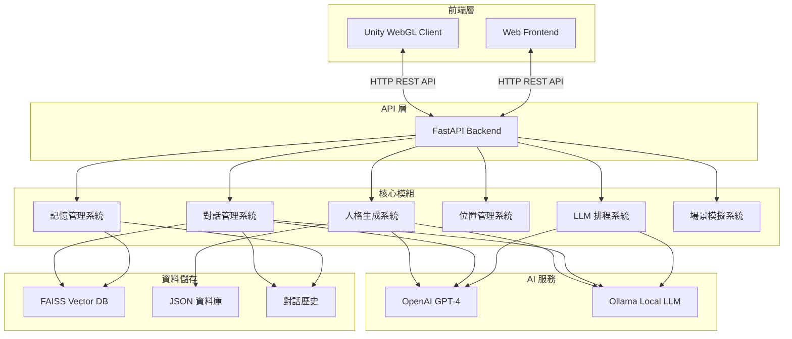
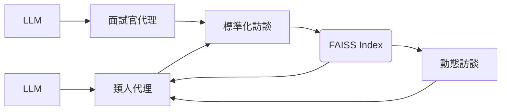

# 🎭 Persona Dough - AI 人格代理人生活模擬系統

> 基於大型語言模型（LLM）的智能人格代理人生活模擬平台，結合 Unity、FastAPI 與 AI 技術，實現具有個性化特徵的虛擬角色自主生活模擬。

[](LICENSE)
[](https://www.python.org/downloads/)
[](https://fastapi.tiangolo.com/)
[](https://unity.com/)

## 📋 目錄

- [專案概述](#-專案概述)
- [核心功能](#-核心功能)
- [系統架構](#-系統架構)
- [快速開始](#-快速開始)
- [詳細文檔](#-詳細文檔)
- [API 文檔](#-api-文檔)
- [專案結構](#-專案結構)
- [技術棧](#-技術棧)
- [使用範例](#-使用範例)
- [常見問題](#-常見問題)
- [授權協議](#-授權協議)

## 🌟 專案概述

Persona Dough 是一個創新的 AI 驅動的人格代理人生活模擬系統。系統能夠：
- 🤖 自動生成具有獨特個性的虛擬角色
- 💬 實現自然語言對話互動
- 📅 智能生成個性化日常排程
- 🎮 整合 Unity 引擎提供視覺化互動介面
- 🔥 模擬複雜場景（如火災逃生等）

**靈感來源**: [Character.AI](https://medium.com/@adlerai/character-attributes-on-character-ai-7ddb95c12d1b)

## ✨ 核心功能

### 1. 🎯 AI 人格生成系統
- **自動生成虛擬角色**：基於 LLM 生成具有獨特個性、背景故事、說話風格的角色
- **自定義角色屬性**：支援指定年齡、性別、職業、個性特質等
- **AI 圖像生成**：自動為角色生成頭像照片
- **人格資料管理**：完整的角色資料庫系統

### 2. 💬 對話系統
- **多人對話模擬**：支援單人面試、雙人對話、群組對話
- **Unity 整合**：專門設計的 Unity 對話 API
- **記憶系統**：自動載入歷史對話上下文
- **情境感知**：根據角色個性產生符合情境的對話

### 3. 📅 LLM 智能排程系統
- **個性化排程**：基於角色個性自動生成日常活動安排
- **上下文感知**：考慮時間、天氣、季節等環境因素
- **動態調整**：實時根據情況調整排程
- **多樣性保證**：避免重複單調的活動安排

### 4. 🗺️ 位置管理系統
- **智能位置匹配**：根據活動類型自動選擇合適地點
- **地理資訊整合**：完整的地點資料庫
- **動態位置更新**：實時追蹤角色位置

### 5. 🔥 場景模擬系統
- **火災逃生模擬**：模擬緊急情況下的人群行為
- **Server-Sent Events (SSE)**：實時推送模擬狀態
- **多角色協作**：模擬多個角色的互動行為

### 6. 🎮 Unity 整合
- **WebGL 網頁應用**：可在瀏覽器中運行的 Unity 應用
- **視覺化介面**：直觀的 3D/2D 互動介面
- **記憶系統整合**：Unity 專用記憶管理系統

## 🏗️ 系統架構



### 資料流程圖



## 🚀 快速開始

### 系統需求

- Python 3.9 或更高版本
- Anaconda 或 Miniconda（推薦）
- Git
- OpenAI API Key 或 Ollama（本地 LLM）

### 安裝步驟

#### 1. 建立 Python 環境

使用 Anaconda 建立虛擬環境：

```bash
conda create --name llm-agent python=3.13
```

#### 2. 啟動環境

```bash
conda activate llm-agent
```

#### 3. 克隆專案

```bash
cd {your-workspace}
git clone {this-repo}
cd persona-dough
```

#### 4. 安裝依賴

```bash
pip install -r requirements.txt
```

#### 5. 設定環境變數

建立 `.env` 檔案並設定 API Keys：

```bash
# OpenAI API（擇一使用）
OPENAI_API_KEY=your_openai_api_key_here

# 或使用 Ollama 本地 LLM
USE_OLLAMA=true
OLLAMA_MODEL=llama2
```

#### 6. 啟動後端服務

使用提供的批次檔（Windows）：

```bash
# 啟動主要後端
run_backend.cmd

# 或直接使用 Python
python backend.py
```

後端將在 `http://localhost:8000` 啟動

#### 7. 啟動 Ngrok（可選，用於外部訪問）

```bash
ngrok_token_register.cmd  # 首次使用需註冊 token
run_ngrok.cmd             # 啟動 ngrok 隧道
```

### 快速測試

訪問以下網址測試系統：

- 主頁面：`http://localhost:8000`
- API 文檔：`http://localhost:8000/docs`
- Unity 應用：`http://localhost:8000/unity-app`
- 排程控制：`http://localhost:8000/llm-schedule-control`
- 火災模擬：`http://localhost:8000/fire_simulation`

## 📖 詳細文檔

### 核心文檔

- [📘 Backend API 完整文檔](Backend_API_Documentation.md) - 所有 API 端點的詳細說明
- [🎮 Unity 專案系統報告](Unity專案系統報告.md) - Unity 整合完整指南
- [📅 LLM 智能排程系統說明](LLM智能排程系統說明.md) - 排程系統詳細說明
- [🗺️ Location Manager 修復說明](Location_Manager_修復說明.md) - 位置管理系統文檔
- [🔥 火災模擬文檔](FIRE_SIMULATION_DOCUMENTATION.md) - 場景模擬系統說明
- [💬 Unity 對話系統](UNITY_DIALOGUE_SYSTEM.md) - Unity 對話系統整合

### 使用指南

- [📋 每日行程安排使用說明](每日行程安排使用說明.md)
- [🌐 網頁行程管理使用說明](網頁行程管理使用說明.md)
- [⏰ 時間系統說明](時間系統說明.md)

### 系統規格

- [🤖 類人代理 Spec](humanoid/humanoid_spec.md)
- [🎤 AI 面試官 Spec](interviewer/interviewer_spec.md)
- [📊 人格屬性字典](humanoid/personality_dic.md)

## 🔌 API 文檔

### 主要 API 端點

#### 人格生成 API

```bash
# 生成隨機人格
POST /api/generate-persona
{
  "count": 1,
  "requirements": "25歲女性，外向開朗"
}

# 取得所有人格列表
GET /api/personas

# 取得特定人格詳細資訊
GET /api/persona/{persona_id}
```

#### 對話 API

```bash
# Unity 專用對話 API
POST /unity-api/dialogue
{
  "persona1_id": "687a1b2d5b",
  "persona2_id": "eef4720230",
  "num_rounds": 3,
  "initial_topic": "你好，很高興見到你！"
}

# 雙人對話
POST /api/dialogue/dual
{
  "persona1_id": "id1",
  "persona2_id": "id2",
  "num_rounds": 5
}
```

#### LLM 排程 API

```bash
# 生成單個活動
POST /api/llm-schedule/generate-activity
{
  "persona_id": "687a1b2d5b",
  "time_slot": "早上",
  "duration_minutes": 60,
  "weather": "晴朗"
}

# 生成一天排程
POST /api/llm-schedule/generate-daily
{
  "persona_id": "687a1b2d5b",
  "date": "2026-01-24"
}

# 取得排程
GET /api/llm-schedule/{persona_id}?date=2026-01-24
```

#### 生活模擬 API

```bash
# 開始模擬
POST /api/simulation/start
{
  "persona_ids": ["id1", "id2"],
  "duration_hours": 24
}

# 取得模擬狀態
GET /api/simulation/status/{simulation_id}
```

#### 場景模擬 API

```bash
# 開始火災模擬
POST /api/fire-simulation/start
{
  "building_layout": {...},
  "num_agents": 20
}

# 取得模擬更新（SSE）
GET /api/fire-simulation/stream/{simulation_id}
```

完整 API 文檔請訪問：`http://localhost:8000/docs`

## 📁 專案結構

```
persona-dough/
├── 📄 backend.py                      # 主要 FastAPI 服務器
├── 📄 life_simulation_backend.py      # 生活模擬後端
├── 📄 llm_scheduler.py                # LLM 智能排程系統
├── 📄 location_function_tools.py      # 位置管理工具
├── 📄 scenario_simulator.py           # 場景模擬器
│
├── 📁 module/                         # 核心功能模組
│   ├── LLM_responder.py              # LLM 回應處理
│   ├── PERSONA_loader.py             # 人格資料載入
│   ├── QA_loader.py                  # 問答資料載入
│   └── prompt_loader.py              # 提示詞載入
│
├── 📁 humanoid/                       # 人格代理人生成系統
│   ├── __init__.py
│   ├── humanoid_spec.md              # 系統規格
│   └── personality_dic.md            # 人格屬性字典
│
├── 📁 interviewer/                    # 面試官系統
│   ├── __init__.py
│   └── interviewer_spec.md           # 系統規格
│
├── 📁 simulation_framework/           # 模擬框架
│   └── core/                         # 核心模擬組件
│
├── 📁 unity_memory/                   # Unity 記憶系統
│   └── [persona_id]/                 # 各角色記憶檔案
│
├── 📁 conversation_history/           # 對話歷史記錄
│   └── *.json                        # 對話歷史檔案
│
├── 📁 simulation_results/             # 模擬結果輸出
│   └── [simulation_id]/              # 各次模擬結果
│
├── 🌐 frontend.html                   # 主要前端頁面
├── 🌐 fire_simulation.html            # 火災模擬頁面
├── 🌐 llm_schedule_control.html       # LLM 排程控制頁面
│
├── 📜 requirements.txt                # Python 依賴套件
├── 📜 README.md                       # 本檔案
│
├── 🚀 run_backend.cmd                 # 啟動後端腳本
├── 🚀 run_ngrok.cmd                   # 啟動 ngrok 腳本
├── 🚀 generate_5_persona.cmd          # 生成 5 個人格腳本
└── 🚀 generate_interview.cmd          # 生成面試腳本
```

## 🛠️ 技術棧

### 後端技術

| 技術 | 版本 | 用途 |
|------|------|------|
| Python | 3.9+ | 主要開發語言 |
| FastAPI | 0.100+ | Web 框架 |
| Uvicorn | - | ASGI 伺服器 |
| OpenAI | - | GPT-4 API |
| Ollama | - | 本地 LLM 支援 |
| FAISS | - | 向量資料庫 |
| Pydantic | - | 資料驗證 |
| SSE-Starlette | 1.6.5 | Server-Sent Events |
| Aiohttp | - | 非同步 HTTP 客戶端 |
| Pillow | - | 圖像處理 |

### 前端技術

| 技術 | 用途 |
|------|------|
| Unity | 3D 互動介面 |
| Unity WebGL | 網頁部署 |
| HTML5 | 網頁介面 |
| JavaScript | 前端邏輯 |
| CSS3 | 樣式設計 |

### 開發工具

- Git - 版本控制
- Ngrok - 內網穿透
- Anaconda - Python 環境管理
- VS Code - 推薦的 IDE

## 🎯 使用範例

### 範例 1：生成一個新角色

```python
import requests

# 生成角色
response = requests.post("http://localhost:8000/api/generate-persona", json={
    "count": 1,
    "requirements": "30歲男性軟體工程師，內向但熱愛編程"
})

persona = response.json()["personas"][0]
print(f"生成角色：{persona['姓名']}")
print(f"ID：{persona['id']}")
```

### 範例 2：讓兩個角色對話

```python
# 啟動對話
response = requests.post("http://localhost:8000/unity-api/dialogue", json={
    "persona1_id": "id1",
    "persona2_id": "id2",
    "num_rounds": 3,
    "initial_topic": "你平常都做什麼工作？"
})

dialogue = response.json()
for round in dialogue["dialogue_rounds"]:
    print(f"{round['speaker']}: {round['content']}")
```

### 範例 3：為角色生成一天排程

```python
# 生成排程
response = requests.post("http://localhost:8000/api/llm-schedule/generate-daily", json={
    "persona_id": "id1",
    "date": "2026-01-24"
})

schedule = response.json()
for activity in schedule["schedule"]:
    print(f"{activity['time_range']}: {activity['activity_name']} @ {activity['location']}")
```

## 🧪 測試

執行測試腳本：

```bash
# 測試排程 API
python test_schedule_api.py

# 測試智能位置系統
python test_smart_location_system.py

# 測試網頁介面
python test_web_interface.py
```

## 📊 專案特色

### 🎨 創新性
- 結合 LLM 與傳統模擬技術
- 實現真正的個性化 AI 角色
- 動態且智能的排程生成

### 🔧 技術亮點
- 前後端分離架構
- RESTful API 設計
- 即時通訊（SSE）
- 向量資料庫整合
- Unity WebGL 部署

### 🌐 實用性
- 完整的文檔支援
- 易於擴展的模組化設計
- 豐富的 API 端點
- 批次腳本快速啟動

## 🤝 貢獻指南

歡迎貢獻！請遵循以下步驟：

1. Fork 本專案
2. 建立您的功能分支 (`git checkout -b feature/AmazingFeature`)
3. 提交您的更改 (`git commit -m 'Add some AmazingFeature'`)
4. 推送到分支 (`git push origin feature/AmazingFeature`)
5. 開啟一個 Pull Request

## 📝 版本歷史

- **v1.0.0** - 初始版本
  - 基本人格生成功能
  - 對話系統
  - Unity 整合

- **v2.0.0** - LLM 智能排程
  - 新增 LLM 排程系統
  - 位置管理系統
  - 火災模擬功能

## 🐛 已知問題

請查看 [Issues](../../issues) 頁面了解當前已知問題。

## 🗺️ 未來規劃

- [ ] 支援更多 LLM 模型（Claude、Gemini 等）
- [ ] 增加更多場景模擬類型
- [ ] 改進 Unity 視覺效果
- [ ] 添加語音對話功能
- [ ] 支援多語言界面
- [ ] 移動端應用開發

## 💡 常見問題

### Q: 如何切換到本地 LLM？
A: 在 `.env` 檔案中設定 `USE_OLLAMA=true` 並安裝 Ollama。

### Q: 為什麼對話生成很慢？
A: LLM API 調用需要時間，建議使用本地 Ollama 或升級 OpenAI 計畫。

### Q: 如何添加自定義地點？
A: 編輯 `location_function_tools.py` 中的地點資料庫。

### Q: Unity 應用無法載入怎麼辦？
A: 確保後端服務正在運行，並檢查瀏覽器控制台錯誤訊息。

### Q: 如何生成多個角色？
A: 使用 `generate_5_persona.cmd` 批次腳本或調用 API 並設定 `count` 參數。

## 📧 聯絡方式

如有問題或建議，請開啟 Issue 或聯繫開發團隊。

## 📚 參考資料

- [Character.AI Character Profile Definition Example](https://medium.com/@adlerai/character-ai-character-profile-definition-example-template-0a5eaf86ec5b)
- [Character Attributes on Character.AI](https://medium.com/@adlerai/character-attributes-on-character-ai-7ddb95c12d1b)
- [Creating a Character.AI Character Profile](https://medium.com/@adlerai/creating-a-character-ai-character-profile-5d50d2007a7f)

## 📄 授權協議

本專案採用 MIT 授權協議 - 詳見 [LICENSE](LICENSE) 檔案。

## 🙏 致謝

- 感謝 [Character.AI](https://character.ai/) 提供靈感
- 感謝 OpenAI 提供強大的 GPT-4 API
- 感謝所有開源社群的貢獻者

---

<div align="center">

**⭐ 如果這個專案對您有幫助，請給我們一個星星！**

Made with ❤️ by Persona Dough Team

</div>
